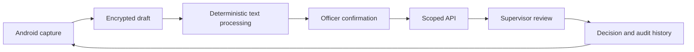

# Architecture

Android Kotlin and Compose capture one photograph, a voice memo, optional cached location and editable text. A Keystore-backed encrypted file holds the draft and queue. One explicit confirmation freezes the draft. Sync posts the stable inspection ID and last report version to the same API used by the browser. The backend scopes every report to the authenticated organization and department. Officers can access only their own submissions.

The deterministic municipal rules suggest a category and redact common identifier patterns in the draft observation. Officers can change those suggestions. The source transcript remains editable. JPEG evidence is user supplied and linked by SHA-256. The server records submission and supervisor decisions in the same database transaction as the status changes.

## Implementation coverage

The browser and service run on Node with SQLite. This keeps the local build dependency-free. SaaS screens cover login, onboarding, employee roles, inspections, review, audit, devices, recent private-server execution traces and the bundled fictional workflow. Android stores a single draft or queued inspection at a time. Device status updates require a manual refresh. The device list records a model label at sync.

A baseline sanitation schema comes with a fictional SOP. Administrators can upload a plain-text SOP containing an explicit Required fields line and verify the proposed schema against the retained source. Publishing is tenant- and department-scoped. Each report keeps its workflow version through correction cycles. Agent configuration, general document ingestion, organization-wide platform administration, automatic notifications, approved report export and multi-pack configuration remain follow-on work. Revenue, hospital operations, police administration and citizen assistance are extension candidates. Official government integrations would require independently provisioned access.

## API

POST /api/login, /api/logout, /api/organizations, /api/employees, /api/process and /api/inspections. GET /api/me, /api/employees, /api/inspections, /api/inspections/{id}, /api/inspections/{id}/evidence, /api/events and /api/devices. Review with POST /api/inspections/{id}/decision. Use a same-origin session cookie or Bearer token. JSON write requests require application/json.